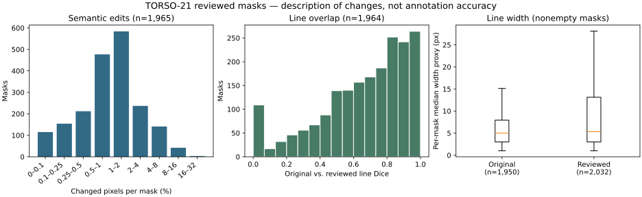

# TORSO-21 reviewed field-line masks

[](https://github.com/yacinezah/torso21-reviewed-field-lines/actions/workflows/verify.yml)
[Download v0.1.0](https://github.com/yacinezah/torso21-reviewed-field-lines/releases/tag/v0.1.0) · [Dataset card](DATASET_CARD.md) · [Audit](FINAL_RELEASE_AUDIT.md)

Thin painted lines in the original real-world TORSO-21 masks can be missing,
fragmented, or confused with other bright regions. During my ITAndroids
internship, I reviewed **2,400 field-line masks** and built a reproducible
overlay that maps each mask to its exact source frame. **1,965 masks** have
class-label changes; **435** retain the original labels after applying the
upstream field-palette rule. The workflow included drawing, erasing, and
reviewing model suggestions. Independent annotation accuracy has not been measured.



The plots describe differences between versions. They do not measure which
version better matches the image.

## Verify the release and use the overlay

Use Python 3.11 in a fresh environment. Run these commands from the downloaded
release or a checkout of the `v0.1.0` tag. The first verification uses only
the files in this repository.

```sh
python -m pip install -r requirements-lock.txt
python -m pip install --no-build-isolation --no-deps .
python -m torso_line_corrections verify
python -m torso_line_corrections stats
```

If you already have TORSO-21, point the tool to the `reality` directory
containing `train/` and `test/`. It checks the source image and mask SHA-256
for each pair, then writes reviewed masks to a separate output directory.

```sh
python -m torso_line_corrections verify --torso-root /path/to/reality
python -m torso_line_corrections materialize --torso-root /path/to/reality --output ../reviewed
```

Otherwise, get the official [train](https://data.bit-bots.de/TORSO-21/reality/train.zip)
and [test](https://data.bit-bots.de/TORSO-21/reality/test.zip) ZIPs (about 5.7 GB combined).
The extractor selects only the required members, checks their SHA-256, and
normalizes three archive filenames for Windows.

```sh
python -m torso_line_corrections extract-source --train-zip train.zip --test-zip test.zip --output ../verified-torso
```

Mask values are **0** background, **127** line, and **255** exclusive field.
For programmatic access, `torso_line_corrections.core.load_pair` returns the
verified image path and the original and reviewed native grids. The original
grid uses value 126 to mark unresolved shades below 127.

## Evidence and reproducibility

The [CSV](manifests/reviewed_masks_manifest.csv) and [Parquet](manifests/reviewed_masks_manifest.parquet)
manifests map every row to its upstream archive members, acquisition group,
and source and reviewed SHA-256 values. See the [change analysis](DATASET_QUALITY_RESULTS.md),
[lineage](PROVENANCE_RECONSTRUCTION.md), and [source and license ledger](SOURCE_AND_LICENSE_LEDGER.md).
To recompute the geometry table, run `python -m torso_line_corrections compare
--torso-root /path/to/reality --output ../geometry.csv`. CI checks the package
and masks without downloading the original data.

The frames were used in a historical model refit; this is an annotation
resource, not an untouched test set. Source imagery is obtained separately.

Original dataset: [Hamburg Bit-Bots and Bestmann et al., TORSO-21](https://github.com/bit-bots/TORSO_21_dataset).
Annotation review and overlay: **Yacine Zahouani**. See [CITATION.cff](CITATION.cff)
and the [upstream MIT notice](LICENSES/TORSO-21-MIT.txt).
